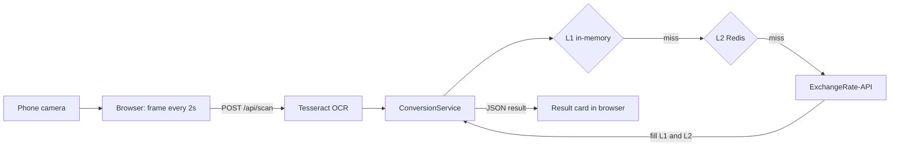

# currency-converter

A web app that reads a price tag through your phone camera and shows the price converted into another currency.

**Live demo:** https://currency-converter-two-silk-96.vercel.app/

## How it works

1. The browser opens the rear camera and, every 2 seconds, captures a frame, scales it to 640 px wide and sends it as a JPEG to the backend (`POST /api/scan`) together with the source and target currency codes.
2. The Spring Boot backend runs Tesseract OCR (via Tess4J) on the frame and extracts the number from the recognised text.
3. The backend looks up exchange rates for the source currency through a two-tier cache, calling ExchangeRate-API only on a miss, and converts the amount.
4. The backend returns the detected amount and the converted amount as JSON, and the page shows them in a result card under the live camera view.



There is also `GET /api/convert?from=USD&to=INR&amount=100`, which converts a given amount without OCR.

## Caching design

Rates are fetched per base currency and stored under the key `rates:<BASE>` (for example `rates:USD`). A lookup checks:

1. **L1, in-memory** (`ConcurrentHashMap` in each backend instance). This is the fastest path and has no network round trip.
2. **L2, Redis**, which is shared by all instances. A hit here also fills L1.
3. **ExchangeRate-API** if both miss. The result is written to L1 and Redis.

L1 makes repeated scans fast. Redis means a new or restarted instance can reuse rates that another instance already fetched, so the external API (which has a request quota) is called rarely. If Redis is unreachable, the error is logged and the request falls through to the API.

The trade-off is that each instance's L1 is independent, so an instance can keep serving an older rate after Redis has been refreshed. With the current TTLs (L1 24 hours, Redis 1 hour, set in `RateCacheServiceV2`) an L1 entry can be up to a day old. This is acceptable for estimating a price tag in another currency, where rates do not need to be accurate to the second.

## Tech stack

- **Backend:** Java 17, Spring Boot 3.3, Maven
- **OCR:** Tesseract via Tess4J
- **Cache:** in-memory map (L1) and Redis via Spring Data Redis (L2)
- **Rates:** [ExchangeRate-API](https://www.exchangerate-api.com/) v6
- **Frontend:** a single HTML page with vanilla JavaScript and CSS
- **Deployment:** Docker image for the backend; the frontend is hosted on Vercel

## Running locally

### Prerequisites

- Java 17 (Maven itself is provided by the included wrapper, `mvnw`)
- Redis
- Tesseract with English language data (`eng.traineddata`)
- Or, instead of the three above: Docker, plus a Redis instance

On macOS with Homebrew:

```bash
brew install openjdk@17 redis tesseract
brew services start redis
```

`NativeLibConfig` points the native library path at `/opt/homebrew/lib`, so running outside Docker is set up for Homebrew on Apple Silicon. On other systems, use Docker.

### Configuration

The backend reads its settings from environment variables. Copy the example file and edit it:

```bash
cp converter/.env.example converter/.env
```

| Variable | Purpose |
| --- | --- |
| `SPRING_REDIS_HOST`, `SPRING_REDIS_PORT` | Redis address |
| `SPRING_REDIS_PASSWORD` | Redis password (leave empty for a local Redis without auth) |
| `SPRING_REDIS_SSL` | `true` for a hosted Redis over TLS, `false` for local |
| `TESSERACT_PATH` | Folder containing `eng.traineddata` |
| `PORT` | Optional HTTP port, defaults to `8080` |

The ExchangeRate-API key is currently set in `converter/src/main/java/com/example/currency/converter/client/ExchangeRateClient.java`.

### Run the backend with Maven

```bash
cd converter
set -a; source .env; set +a
./mvnw spring-boot:run
```

Or build a jar and run it:

```bash
cd converter
./mvnw clean package -DskipTests
set -a; source .env; set +a
java -jar target/converter-0.0.1-SNAPSHOT.jar
```

### Run the backend with Docker

The image installs Tesseract and its English data at `/usr/share/tessdata`. In `converter/.env`, set `TESSERACT_PATH=/usr/share/tessdata`, and if Redis runs on your host machine set `SPRING_REDIS_HOST=host.docker.internal`.

```bash
docker build -t currency-converter ./converter
docker run -p 8080:8080 --env-file converter/.env currency-converter
```

### Run the frontend

The frontend sends requests to the deployed backend URL set in `BACKEND_SCAN_URL` near the top of the `<script>` block in `frontend/index.html`. To use your local backend, change it to `http://localhost:8080/api/scan`, then serve the folder:

```bash
cd frontend
python3 -m http.server 5500
```

Open http://localhost:5500. Browsers only allow camera access on `localhost` or over HTTPS.

## Project structure

```
currency-converter/
├── converter/                     Spring Boot backend
│   ├── Dockerfile                 Image with Java 17 and Tesseract
│   ├── pom.xml                    Maven build
│   ├── .env.example               Example environment configuration
│   └── src/main/java/.../converter/
│       ├── controller/            REST endpoints (/api/scan, /api/convert)
│       ├── service/               OCR, conversion and the two-tier rate cache
│       ├── client/                ExchangeRate-API client
│       ├── config/                Redis serialisation and native library paths
│       └── dto/                   API response models
└── frontend/
    └── index.html                 Camera UI, scan loop and result display
```

## Possible improvements

- Replace Tesseract with a more accurate OCR model, and only read the region inside the on-screen scan frame.
- Parse prices more strictly. The current parser keeps every digit and dot in the recognised text, so other numbers in the frame can corrupt the amount.
- Read the rates API key and the frontend's backend URL from configuration instead of source code.
- Give L1 a shorter TTL than Redis, so instances pick up refreshed rates sooner.
- Remove unused code (`RateCacheService`, `ConversionResponse`, the OpenCV dependency) and add tests for the cache and the parser.
